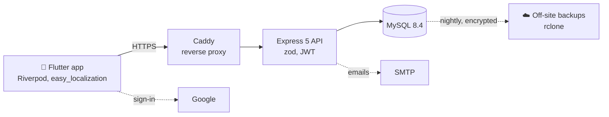

<div align="center">


# GardenFlow

**Plan your vegetable garden, and know what to plant where and when.**

[Website](https://gardenflow.fr) · [Privacy](https://gardenflow.fr/privacy.html) · [Releases](https://github.com/Taglhydz/GardenFlow/releases)

[](https://github.com/Taglhydz/GardenFlow/actions/workflows/ci.yml)
[](https://github.com/Taglhydz/GardenFlow/releases)
[](LICENSE)


</div>

---

GardenFlow is a mobile app to draw your garden as it really is, place your crops in it, and get suggestions of what to sow or plant in each spot this month : season, soil, sunlight, companion plants and crop rotation are taken into account.

## ✨ Features

- 🗺️ **Garden plans** : parcels and zones of any shape, drawn with your finger on a 50 cm grid, with zoom and recenter
- 🌱 **Crops** : place a plant in a zone or in a whole parcel, and choose its color on the plans
- 📅 **Plant catalog** : 30 vegetables and herbs with their sowing, planting and harvest calendar, and 48 good or bad companions
- 💡 **Suggestions** : the plants that fit a zone this month, ranked by season, soil, sunlight, moisture, neighbours, crop rotation and space, each score explained
- 👤 **Accounts** : email or Google sign-in, forgot password, profile photo or plant avatar, gardener level, log out of all devices, account deletion
- 🌍 **French and English**

## 🧭 Roadmap

- [x] Garden plans, crops, suggestions, accounts
- [x] Server files : Docker Compose, HTTPS, encrypted backups
- [x] Website with the privacy policy and the account deletion page
- [ ] Server online
- [ ] App on the Google Play Store
- [ ] "Other" plant with a custom name, for plants missing from the catalog
- [ ] Error tracking and uptime monitoring
- [ ] iOS

## 🏗️ Architecture



| Folder | Content |
| --- | --- |
| [`frontend/`](frontend) | The Flutter app |
| [`backend/`](backend) | The Express API, its migrations and tests |
| [`deploy/`](deploy) | Docker Compose server for a home PC or a VPS, backups |
| [`site/`](site) | The website https://gardenflow.fr |
| [`docs/`](docs) | Development guide and API reference |

## 🚀 Getting started

With an Android phone plugged in over USB, MySQL running and `backend/.env` / `frontend/.env` filled in (copies of the `.env.example` files) :

```bash
cd backend
npm install
npm run migrate     # creates the tables and loads the plant catalog
cd ..
.\dev               # starts the API and runs the app on the phone
```

## 📚 Documentation

| Guide | |
| --- | --- |
| [Development](docs/development.md) | Running the backend and the app, database migrations, release build, translations |
| [API](docs/api.md) | Routes, rules of the plans, how the suggestions are computed |
| [Deployment](deploy/README.md) | Putting the server online, step by step, with backups |

## 📄 License

GardenFlow is released under the [MIT License](LICENSE).
